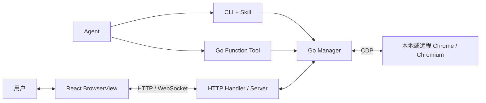

<div align="center">

# Awesome browserkit

**为 Agent 提供本地与远程浏览器操作，以及可嵌入的实时可视化界面。**

[](go.mod)
[](react/README.md)
[](LICENSE)

[English](README.md) · **简体中文**

[核心能力](#capabilities) · [接入方式](#integration) · [本地 Demo](#demo) · [React API](react/README.md)

</div>

Awesome browserkit 将 Chrome / Chromium 的页面操作、实时图流和开发诊断提供给 Agent 与应用。
Agent 可通过 CLI 或 Go 函数读取页面、操作元素和管理 Tab；用户可通过 React 界面观看执行过程、输入内容并接管操作。
浏览器可以运行在本机或远程服务器上，也可以连接已启用 CDP 调试的浏览器。

## 嵌入效果

`BrowserView` 直接挂载在工作台内容区域中，外侧不再重复套一层浏览器卡片。

<div align="center">

</div>

<details>
<summary><kbd>F12</kbd> <strong>Developer tools</strong> — 点击开启或关闭</summary>
<br>

</details>

<details>
<summary><strong>操作权接管</strong> — 点击显示或隐藏</summary>
<br>

</details>

外侧工作台和页面内容用于模拟宿主场景；嵌入面板会在宿主容器内渲染 Tab、地址栏、浏览器输入、操作权接管和诊断面板。[运行可交互 Demo](#demo)。

<a id="capabilities"></a>

## 核心能力

| 能力 | 说明 |
| --- | --- |
| **已有环境接管** | 连接已授权的 Chrome / Chromium，使用现有 Cookie、登录态和页面上下文。默认绑定激活 Tab，断开连接后保留浏览器与页面。 |
| **独立浏览器环境** | CLI 的 `new` 模式创建临时 profile，在无头浏览器中执行任务。Cookie 和本地存储与日常浏览器及其他 client 进程隔离，退出时清理。 |
| **面向 Agent 的页面操作** | 页面快照提供文本、元素引用和版本信息。支持点击、悬停、文本输入、按键、导航、等待、截图与 Tab 管理，可封装为宿主框架的 Function Tool。 |
| **元素与区域选择** | 控制方可以在 React 画面中选取元素或拖拽区域并填写批注。元素结果包含可供后续操作的版本化 ref；区域结果包含视口坐标和 PNG Blob。Go 截图接口也支持按视口区域裁剪。 |
| **实时图流** | 通过 WebSocket 传输浏览器渲染帧，按容器尺寸显示。Go 端可配置帧率与 JPEG 质量档位，慢连接跳过旧帧，减少画面积压。 |
| **远程可视化操作** | React 界面提供 Tab 栏、地址栏、鼠标、触摸、滚轮、键盘和中文输入法。操作发往浏览器所在机器，页面变化通过图流回传。 |
| **协作与观察** | 多个客户端可观看同一会话，通过操作权协调输入。支持用户接管与服务端只读观察入口，适合展示 Agent 执行过程。 |
| **开发诊断** | 收集 Console、运行时异常、Network 请求和页面资源。F12 面板支持筛选与详情查看，Agent 可通过诊断函数读取记录。 |
| **组件定制** | 按客户端配置区域、按钮、输入类型、键盘唤起方式和诊断面板。通过 CSS 变量、class 与 `style` 调整外观和尺寸。 |

诊断面板提供 Console、Network 和 Resources，暂不支持 Elements 编辑或 JavaScript 断点调试。
会话状态保存在进程内，服务重启后不自动恢复。

### 控制与可视化链路



CLI、Go 函数和 HTTP Handler 使用 `Manager` 管理会话与页面。
React 显示浏览器画面并传递输入；网页脚本和网络请求在 Chrome / Chromium 中执行。

<a id="integration"></a>

## 选择接入方式

| 使用方式 | 适合场景 | 入口 |
| --- | --- | --- |
| **本地 Skill** | Agent 使用本机已有登录态，或在独立环境中完成浏览任务 | [CLI 与 Skill](#local-skill) |
| **独立服务** | 浏览器集中运行在服务器上，客户端远程观看和操作 | [HTTP 服务](#http-service) |
| **嵌入应用** | 为 Agent 产品、工作台或业务应用增加浏览器操作与可视化 | [Go 与 React](#embedding) |

## 环境与源码

- Go 1.25.8+。
- Chrome / Chromium：安装在运行浏览器的机器上。
- Node.js 22+：构建 React 组件或 demo 时需要。组件支持 React 19。

```sh
git clone https://github.com/zeoxisca/awesome-browserkit.git
cd awesome-browserkit
go mod download
```

以下构建命令在仓库根目录执行，依赖安装命令在使用该依赖的应用目录执行。

<a id="local-skill"></a>

## 1. CLI 与 Skill

安装脚本会构建 client 并配置 Agent Skill，默认目标为 Codex：

```sh
./install.sh
export PATH="$HOME/.local/bin:$PATH"
browserkit --version
```

默认 client 目录为 `~/.local/bin`，Skill 目录为 `${CODEX_HOME:-~/.codex}/skills/browserkit-cli`。

配置给 Pi Agent，或同时配置给两个 Agent：

```sh
./install.sh --agent pi
./install.sh --agent all
```

Pi Skill 默认安装到 `${PI_CODING_AGENT_DIR:-~/.pi/agent}/skills/browserkit-cli`；新建 Pi 会话后可用 `/skill:browserkit-cli` 显式调用。使用 `BROWSERKIT_BIN_DIR`、`BROWSERKIT_CODEX_SKILL_DIR` 和 `BROWSERKIT_PI_SKILL_DIR` 修改对应位置；旧的 `BROWSERKIT_SKILL_DIR` 仍可覆盖所选目标的 Skill 目录。
Agent 操作约定见 [Skill](skills/browserkit-cli/SKILL.md)。

### 接管已有浏览器

在 Chrome 打开 `chrome://inspect/#remote-debugging`，启用「允许调试本浏览器」。
若当前版本没有此选项，需要升级 Chrome。
记录调试地址，切回目标 Tab；连接时在 Chrome 中确认授权提示。

```sh
browserkit --mode attach --remote 'http://127.0.0.1:9222'
```

将示例地址替换为实际 CDP 入口，支持 HTTP `/json/version` 或 browser WebSocket。
默认接管激活 Tab；Chrome 失焦时选择唯一可见 Tab。
多个窗口导致目标不明确时，切回目标页并保持浏览器焦点后重试。
退出 client 会断开连接，保留浏览器和 Tab。

### 启动独立浏览器

```sh
browserkit --url 'https://example.com'
```

默认 `new` 模式使用临时 profile，以无头模式运行。
所有本地启动的会话（包括库调用和 HTTP 服务）各有独立临时 profile。Cookie 和本地存储与日常浏览器隔离；关闭会话时删除 profile。显式设置 `SessionConfig.UserDataDir` 时沿用原有清理配置。
认证代理、证书配置、宿主管理会话寿命、上传和下载跟踪见 [Go SDK 配置与调用示例](docs/host-sdk.md)。
本地浏览器默认从实际安装的 Chrome 版本生成桌面 UA，并将其作为会话 profile 的身份设置；只有显式设置 `SessionConfig.UserAgent` 才覆盖 UA。无法读取版本时沿用 Chrome 自身的身份。启动时移除 Rod 的自动化标记和站点隔离覆盖，并禁用 Blink 的 `AutomationControlled` 特性。远程浏览器保持原有 profile 与启动设置。
不传 `--url` 时，由 Agent 创建页面。

### `--url`

所有模式下，`--url` 都在所使用的浏览器中新建 Tab 并打开地址，包括已有同地址 Tab 的情况。
例如，在已连接的浏览器中打开新 Tab：

```sh
browserkit --mode attach --remote 'http://127.0.0.1:9222' --url 'https://example.com/workspace'
```

<a id="http-service"></a>

## 2. HTTP 服务

```sh
make server
./browserkit-server --addr 0.0.0.0:8787 \
  --url https://example.com \
  --allowed-origins https://app.example.com
```

默认监听 `127.0.0.1:8787`，浏览器入口为 `/browser`，健康检查为 `/healthz`。
`--remote` 可指定已有浏览器；省略 `--url` 时等待客户端创建页面。
`--allowed-origins` 接受逗号分隔的前端 Origin。

按下方[组件安装](#react-install)生成并安装 React 包，然后连接服务：

```tsx
import { BrowserView } from '@browserkit/react'
import '@browserkit/react/style.css'

export function RemoteBrowser() {
  return <BrowserView
    endpoint="https://browser.example.com/browser"
    style={{ width: '100%', height: 640 }}
  />
}
```

<a id="embedding"></a>

## 3. 嵌入应用

### Go

```sh
go get github.com/zeoxisca/awesome-browserkit
```

```go
import (
    "context"
    "net/http"
    "os"

    browserkit "github.com/zeoxisca/awesome-browserkit"
    "github.com/zeoxisca/awesome-browserkit/browserhttp"
)

func mountBrowser(ctx context.Context, mux *http.ServeMux) (*browserkit.Manager, error) {
    manager, err := browserkit.NewManager(browserkit.Config{AllowDevtools: true})
    if err != nil { return nil, err }
    if _, err = manager.Open(ctx, browserkit.OpenRequest{URL: "https://example.com"}); err != nil {
        _ = manager.Close(context.Background())
        return nil, err
    }
    mux.Handle("/browser/", http.StripPrefix("/browser",
        browserhttp.NewHandler(manager, browserhttp.Options{})))
    return manager, nil
}
```

`browserhttp.Options.AuthMiddleware` 使用标准 Go HTTP middleware 形式，可接入宿主已有的 Bearer Token、Cookie Session、mTLS 或反向代理身份认证。它位于所有 BrowserKit 路由之前，同一中间件同时保护普通 HTTP 和 WebSocket 握手：

```go
authenticate := func(next http.Handler) http.Handler {
    return http.HandlerFunc(func(w http.ResponseWriter, r *http.Request) {
        if r.Header.Get("Authorization") != "Bearer "+os.Getenv("BROWSERKIT_TOKEN") {
            http.Error(w, "unauthorized", http.StatusUnauthorized)
            return
        }
        next.ServeHTTP(w, r)
    })
}

handler := browserhttp.NewHandler(manager, browserhttp.Options{
    AuthMiddleware: authenticate,
})
```

以上仅为接口示例；生产环境应使用宿主正式的身份系统和恒定时间令牌校验。`AllowedOrigins` 只限制浏览器跨源调用，不代替认证。

默认禁止浏览器访问本机、私网、链路本地和其他非公网地址。内置 Rod/CDP 会话会在每个 HTTP(S) 或 WebSocket 请求发出前解析并检查全部 IP；检查覆盖重定向、iframe、脚本、图片、XHR/Fetch 等子资源。配置 `AllowedOrigins` 时，Document 导航及每个重定向跳转也会再次校验 origin。只有可信的本地开发场景才应设置 `AllowPrivateNetwork: true`。自定义 `SessionFactory` 必须在自己的浏览器传输层执行等价策略。

应用退出时调用 `manager.Close(context.Background())`。
`Manager.Functions()` 返回绑定该 Manager 的工具函数：

将函数的 `Name`、`Description` 和 `Handler` 交给宿主工具注册器。
`Handler` 的签名为 `func(context.Context, Request) (Response, error)`。

请求和响应使用导出的命名结构体，宿主负责 Schema 校验和工具调用协议。
全部工具输入字段（含嵌套字段）通过 `jsonschema_description` 提供中文参数说明，涵盖用途、默认值和约束。
`browserNavigate` 不再接受未使用的 `timeout_ms` 字段。
打开或导航页面时，加载完成与页面空闲共用最多 3 秒的等待窗口；浏览器启动和导航请求仍受 `Session.OperationTimeout` 与宿主 context 限制。
超过等待窗口后页面继续加载，调用成功返回 `load_status: "timeout"`、当前页面 `snapshot` 和未完全加载提醒 `warning`。
模型可直接使用快照中的元素引用继续操作，或调用 `browserWait`、`browserSnapshot` 检查后续状态；无需重新打开或导航。
若当前内容暂时无法读取，`warning` 会包含读取失败原因，页面仍保留。
适配示例见 [examples/functions](examples/functions/main.go)。

### 批量动作与增强观测

`browserAct` 按顺序执行最多 20 个动作，只在最后返回一次快照；单独动作也会附带最新快照。
`snapshot_error` 表示动作已经完成，但附加读取或等待失败，应先检查页面，避免重复副作用。
`browserSetChecked` 设置勾选状态，`browserDrag` 支持指针和 HTML5 拖放，
`browserNavigate` 的 `direction=back/forward` 支持历史导航。
`browserTabs` 支持 `action=list/activate/close/new/reload`，并保留原有的 `browserActivateTab` 和 `browserCloseTab` 工具。
原生 JavaScript 弹窗通过 `snapshot.dialogs` 暴露，用 `browserHandleDialog` 和返回的 ID 明确接受或取消。

快照补充表单值与控件状态，对敏感值做屏蔽并限制正文和字段值预算。
快照和部分动作支持 `include_screenshot`，快照的 `screenshot_grid` 与截图的 `grid` 可附带 CSS 坐标网格。
配置 `Config.DownloadDir` 或 CLI 的 `--download-dir` 后启用本地下载；远程 CDP 会话不支持该下载目录。
`browserDownload.start` 只报告点击完成事实并返回 `download_unconfirmed`，不猜测下载归属；用 `list` 发现实际下载，再按 `download_id` 查询或等待。
CLI 还支持 `--upload-dir` 开启上传。
自定义 `Page` 实现需适配扩展动作接口，详见[迁移与兼容说明](docs/keycode-browser-port.md)。

### 操作序列生成与回放

BrowserKit 不内置模型调用；宿主 AI 使用现有 `browserSnapshot`、`browserClick`、`browserType` 等工具探索页面。调用 `sequenceStart` 后，成功的导航、点击和输入会成为候选步骤；脚本和外部能力分别通过 `sequenceScript`、`sequenceProviderCall` 显式加入候选。模型用 `sequenceRead` 检查候选，再由 `sequenceFinish` 按原执行顺序删减和分组，不能改写定位器或动作内容。

最终序列使用 `schema_version: 1`，输入保存为变量占位符并在变量表保留默认值。`sequenceFinish` 将序列保存为 JSON：未提供 `output_path` 时创建权限为 `0600` 的临时文件，提供路径时写入该文件且拒绝覆盖已有文件；响应中的 `path` 始终返回实际绝对路径。`sequenceReplay` 总是另启本地临时 Chrome profile，不继承探索浏览器的 Cookie 或本地存储。点击不会回放旧 mousemove 或旧坐标，而是在重新定位元素后，从当前指针位置到元素当前可点击中心生成平滑轨迹。遇到 `provider-call` 时回放返回 `needs_provider` 和一次性 token；宿主取得验证码等外部结果后调用 `sequenceResume` 继续。

BrowserView 工具栏还提供用户手动录制按钮。开启后，后端把用户的页面导航、点击和连续文本输入归并为与 Agent 探索相同的定位器、变量和语义步骤，不保存鼠标移动或逐键低层事件。点击停止后可选择临时文件或指定 JSON 文件；指定文件同样不会覆盖已有内容。录制状态和候选数量通过现有 state WebSocket 同步，刷新页面不会在前端伪造第二份状态。

序列相关工具刻意不使用 `browser` 前缀；已有 Function Tool 名称保持不变。回放完成、失败或暂停后 session 都会保留，调用方检查完毕后使用 `browserClose` 释放。

### React

完成[组件安装](#react-install)后，在应用中使用：

```tsx
import { BrowserView } from '@browserkit/react'
import '@browserkit/react/style.css'

export function BrowserPanel() {
  return <BrowserView endpoint="/browser" style={{ height: 560 }} />
}
```

组件区域、输入和诊断配置见 [React API](react/README.md)。
传入 `onElementSelect` 或 `onAreaSelect` 后会显示选择按钮。只有浏览器控制方可检查元素；宿主收到元素 ref、区域图片和批注后自行决定用途。Go 端可调用 `Manager.InspectPoint`，HTTP 端可调用 `POST /tabs/{pageID}/inspect`。`ScreenshotRequest.Region` 使用选择区域时的视口尺寸裁剪截图，不能与 `FullPage` 同时使用。
默认的 `httpBrowserSource` 使用 BrowserKit HTTP/WebSocket 入口。接入宿主已有浏览器传输层时，可传入 `BrowserSource`；此时 `endpoint` 是传给数据源方法的标识，宿主自行管理 Tab 时还可指定 `pageID`。独立挂载 React 根可运行 `npm run build:standalone --prefix react`，加载 `react/standalone/browser.js` 和 `react/standalone/react.css`，再调用模块导出的 `mountBrowserView(element, props)`。

<a id="react-install"></a>

## React 组件安装

组件尚未发布到 npm。先在 Awesome browserkit 仓库生成安装包：

```sh
npm ci --prefix react
make pack
```

在 React 项目中安装，替换安装包路径：

```sh
npm install /path/to/awesome-browserkit/react/browserkit-react-0.1.0.tgz
```

项目尚未安装 React 19 时执行：

```sh
npm install react@^19 react-dom@^19
```

<a id="demo"></a>

## 本地启动 Demo

本机安装 Go 1.25.8+、Node.js 22+ 和 Chrome / Chromium 后：

```sh
git clone https://github.com/zeoxisca/awesome-browserkit.git
cd awesome-browserkit
make install
make build
make demo
```

已有源码时，从仓库目录运行最后三条命令。
`make demo` 启动 Go 服务和浏览器，默认打开内置示例网页。
访问 [工作台](http://127.0.0.1:8877/) 或 [快速开始](http://127.0.0.1:8877/#/quickstart)。
按 Ctrl+C 停止服务和浏览器。

修改端口或指定 Chrome 路径：

```sh
go run ./examples/demo --addr 127.0.0.1:8878 --chrome /path/to/chrome
```

测试与开发命令见 [贡献指南](CONTRIBUTING.md)。

### 浏览器函数靶场

运行 `make lab`，在 `http://127.0.0.1:8879/` 启动[工具靶场](internal/toollab/README.md)。
页面包含表单、悬停菜单、异步数据、嵌套和长页滚动、DOM 替换、资源加载及弹出 Tab。
快照包含原生表单标签、复选框角色和下拉选项。`browserSelectOption` 和 `browserAct` 的 `select` 步骤都可用 `values` 或 `labels` 设置原生单选和多选控件，传 `[]` 清空，传 `[""]` 选择空字符串选项。`browserScroll` 在视口中心或指定 CSS 坐标发送滚轮事件。
快照还会发现同源 iframe 和开放 Shadow DOM 内的控件。配置 `Config.UploadDir` 后可以用 `browserUploadFile` 上传该目录内的普通文件，传一个绝对 `path` 或一组绝对 `paths`，单个文件最大 10 MiB。可直接使用文件输入框的 `ref`，也可以传 `chooser: true` 点击打开原生文件选择器的元素。响应列出文件名和字节数。
嵌套同源、跨域 iframe/OOPIF 及其开放 Shadow DOM 共用快照和操作入口，frame 控件使用绑定文档的独立 `f` 前缀 ref。整体文字与元素预算覆盖整个 Tab，元素可用 `next_offset` 续读；`frame_coverage` 明确各文档的覆盖状态和 `shadow_dom=open_only` 范围。变换、裁剪及闭合根的实际边界见 [frame 说明](docs/frame-tool-design.md)。
可以用 `browserkit --allow-private-network --url http://127.0.0.1:8879/` 手动调用函数。
`make smoke` 会在临时浏览器中使用同一靶场，通过 JSON 工具调用验证全部已启用的浏览器函数。

## 许可证

[Apache-2.0](LICENSE)。
